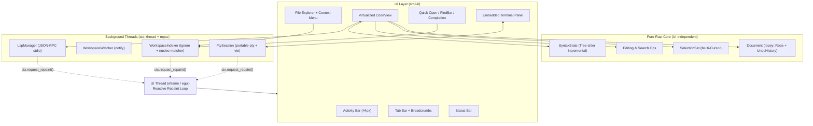

# Kiến trúc hệ thống Draco

Draco được thiết kế theo 3 trụ cột: **Hiệu năng tức thì**, **Tách lớp nghiêm ngặt**, và **Ít phụ thuộc nặng** (không sử dụng `tokio`).

## Sơ đồ luồng dữ liệu

## Các quyết định kỹ thuật cốt lõi

### 1. Virtualized `CodeView` thay cho `egui::TextEdit`
- `Document` lưu nội dung trong `ropey::Rope` cho phép chèn/xóa và ánh xạ `char ↔ byte ↔ line` trong **O(log N)**.
- `Selection` sử dụng **char offset** thay vì byte offset để đảm bảo an toàn 100% với ký tự UTF-8 đa byte (tiếng Việt, emoji).
- Trong mỗi frame, `CodeView` tính dải dòng hiển thị `first_line..=last_line` từ `ScrollArea::show_viewport` và chỉ layout/vẽ đúng ~40–60 dòng đó qua `egui::Painter`.

### 2. Tree-sitter Incremental & Visible-Range Query
- Mỗi thay đổi trong `Document::apply_edits` sinh ra danh sách `EditDelta` (byte offset + `(row, byte_col)`).
- `SyntaxState::sync` gọi `tree.edit(&InputEdit)` rồi `parser.parse_with` đọc trực tiếp chunk từ `Rope` (zero-copy).
- Khi render, `QueryCursor::set_byte_range(vis_start..vis_end)` giới hạn truy vấn chỉ trong vùng đang thấy trên màn hình — giúp file 100.000 dòng vẫn render mượt.

### 3. Reactive Repaint & Lightweight Threading
- Draco không dùng `tokio`. Mọi tác vụ I/O nền (`WorkspaceIndexer`, `LspManager`, `PtySession`) chạy trên `std::thread` chuẩn.
- Mỗi worker giữ một closure `Arc<dyn Fn() + Send + Sync>` bọc `egui::Context::request_repaint()`. Khi đứng yên, CPU sử dụng ~0%.

### 4. Vector Icons không phụ thuộc font ngoài
- `src/ui/icons.rs` vẽ trực tiếp biểu tượng thư mục, chevron, badge ngôn ngữ và Activity Bar bằng `egui::Painter`, giúp binary gọn và hiển thị đồng nhất trên mọi distro Linux / Windows / macOS.
